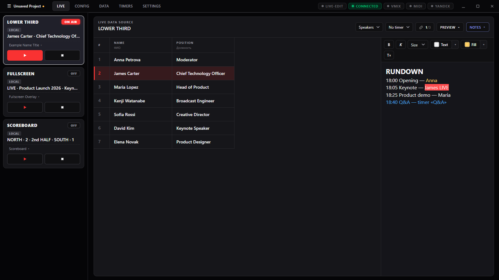
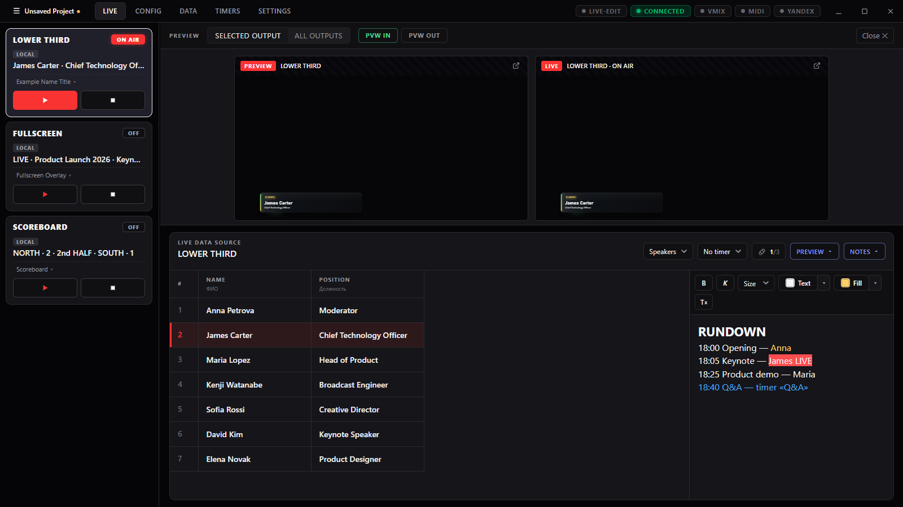
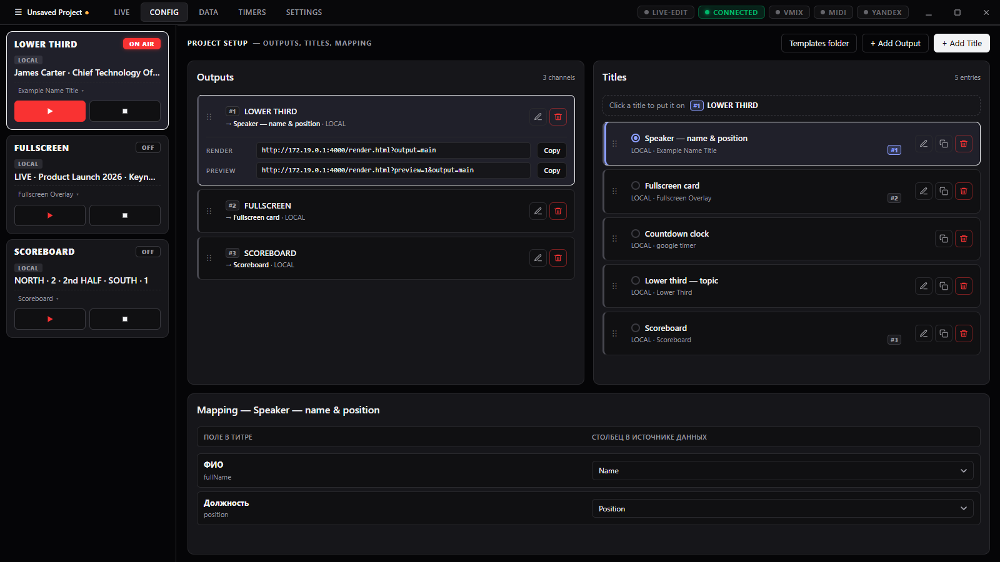
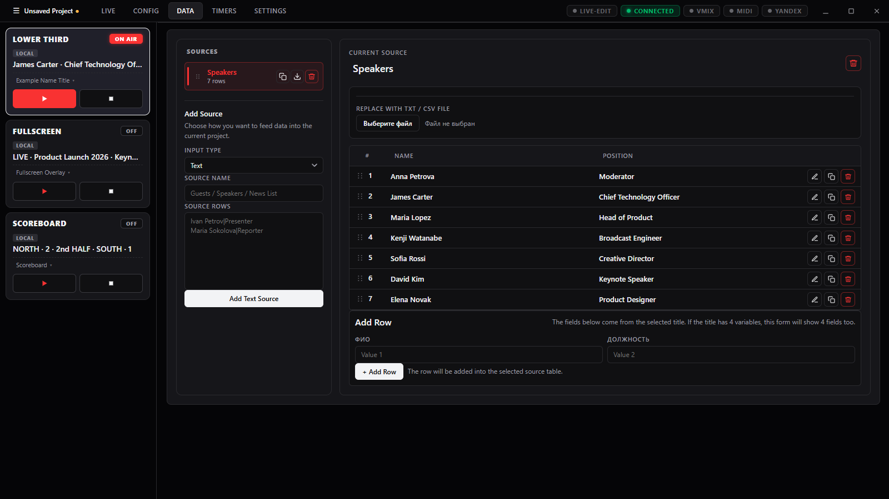
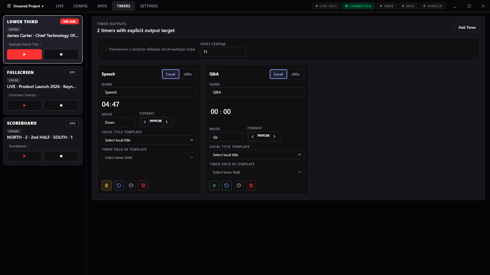
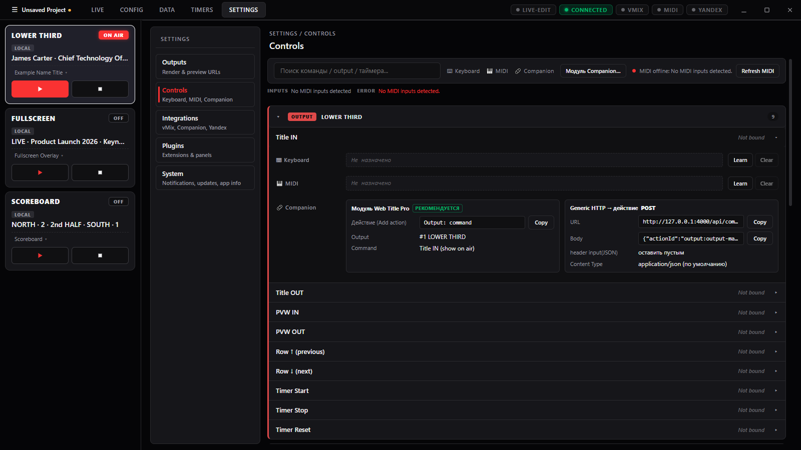

# Web Title Pro

**Live title control for vMix, OBS and any Browser Source — on one Windows desktop app.**
Multiple outputs, data-driven rundowns, timers, notes, keyboard / MIDI / Bitfocus Companion control.

[**⬇ Download the latest installer**](https://github.com/perogello/Web-Title-Pro/releases/latest) · [English](#english) · [Русский](#русский)



---

## English

Web Title Pro (WTP) is a local Windows application for operating live graphics during a show: lower thirds, full-screen cards, scoreboards, countdowns and vMix GT titles. It is built for title operators, directors, stream technicians and small production teams that need fast, reliable control over several outputs without a heavy broadcast graphics system.

Everything runs locally: the app hosts its own web server (port `4000`) that serves the HTML renderer for vMix / OBS and the API for control surfaces.

### Install

1. Download `WebTitlePro-Setup-<version>.exe` from [Releases](https://github.com/perogello/Web-Title-Pro/releases/latest) and run it. It installs for the current user, no admin rights needed.
2. The app updates itself: a new release is downloaded in the background and installed on restart (Settings → System).
3. Projects, sources, plugins and settings live in `%APPDATA%\web-title-pro` and survive updates and reinstalls.

> The installer is not code-signed, so Windows SmartScreen may warn on first run: *More info → Run anyway*.

### Features

#### Live — run the show

The main operator screen. Each **output** (an independent graphics channel — a vMix input, an OBS browser source…) is a card on the left with **IN / OUT**, the selected title and its ON AIR state. In the centre is the **data source** linked to the selected output: click a row to apply it to the title — if the title is on air, it updates right away. Rows can also be stepped from the keyboard, MIDI or Companion, and the highlight follows.

- **Live-edit** switch: edit the on-air title in place, or keep edits off air until you push them.
- **Notes** panel next to the table: a rich-text rundown (colours, highlight, sizes) that stays open whether or not the output has data.
- Resizable columns with text wrapping/clipping, so long tables fit narrow windows.

#### Preview — see before you take

PVW IN / PVW OUT put the title on a preview bus. The preview panel shows the **preview** and **live** frames side by side, for the selected output or for all outputs at once.



#### Config — outputs, titles, mapping

- **Outputs:** add, rename, reorder; each has a **render URL** and a **preview URL** to paste into vMix / OBS as a Browser Source (Copy buttons).
- **Titles:** built-in templates (lower thirds, full-screen card, scoreboard, timers…), your own HTML/CSS/JS templates from the templates folder, and **vMix GT titles** discovered over the vMix API. Click a title to put it on the current output; the `#1`, `#2` badges show which output uses which title.
- **Mapping:** which data column feeds which title field.



#### Data — sources for the rundown

Text typed by hand, **TXT / CSV** files, **CSV by URL**, **Google Sheets** links and **Yandex Disk** public links (XLSX with sheet switching). Rows can be edited, duplicated, reordered and added with a form built from the title's fields; remote sources refresh on demand.



#### Timers

Countdown and count-up timers with formats, colour rules (e.g. red under one minute) and an optional reminder to start the timer after a title is selected. A timer can drive a local title template or a **vMix** GT title (only GT title inputs are listed), and can be linked to data rows (each row with its own duration).



#### Control surfaces — keyboard, MIDI, Bitfocus Companion

Settings → **Controls** lists every command (title IN/OUT, PVW IN/OUT, row ▲/▼, row timer, timers, panic, plugin overlays) per output and per timer:

- **Keyboard** shortcuts with *Learn*; conflicts are flagged.
- **MIDI Learn** for notes, pads, buttons, knobs and faders, with CC value rules (any movement, exact value, at/above or at/below a threshold).
- **Bitfocus Companion:** the bundled **Web Title Pro module** gives buttons with live on-air colours, variables (output names, current values, timer time…) and ready-made presets. Install it into Companion with **one click** (Settings → Integrations); it updates together with the app. For every command the panel also shows the exact fields for the module action and for Companion's Generic HTTP — each with a **Copy** button.



#### Projects

New / Open / Save / Save As (**Ctrl+N / Ctrl+O / Ctrl+S / Ctrl+Shift+S**), Recent projects, autosave of the working draft, and **`.wtpkg` bundles** that pack the project together with its custom templates to move a whole production to another machine. Closing with unsaved changes asks in an in-app dialog.

#### Also

- **Plugins:** sandboxed extensions that add panels, commands and overlays ([guide](docs/PLUGINS.md)).
- **Notifications:** all / errors only / none (Settings → System).
- **Status bar:** Live-edit, server connection, vMix, MIDI, Yandex at a glance.
- **HTTP API + WebSocket** (`/api/command`, `/api/state`, `/ws`) for your own automation — see [Bitfocus Companion → Commands](docs/BITFOCUS.md#commands).

### Documentation

- [Template guide](docs/TEMPLATE_GUIDE.md) — writing your own HTML titles
- [Bitfocus Companion](docs/BITFOCUS.md) · [RU](docs/BITFOCUS_RU.md)
- [MIDI controls](docs/MIDI.md)
- [Plugins](docs/PLUGINS.md) · [RU](docs/PLUGINS_RU.md) · [starter template](docs/plugin-template/)
- [Yandex credentials](docs/YANDEX_CREDENTIALS.md)
- [Project memory](docs/PROJECT_MEMORY.md) — architecture and decisions
- Release notes: [0.5.3](docs/RELEASE_0.5.3.md) · [0.5.2](docs/RELEASE_0.5.2.md) · [0.5.1](docs/RELEASE_0.5.1.md) · [0.5.0](docs/RELEASE_0.5.0.md) · [all releases](https://github.com/perogello/Web-Title-Pro/releases)

### Run from source

```bash
npm install
npm run dev
```

If PowerShell blocks `npm.ps1`, use `npm.cmd` instead of `npm`.

- Control UI: `http://localhost:5173`
- Backend API: `http://localhost:4000`
- Renderer: `http://localhost:4000/render.html`

Desktop app and installer:

```bash
npm run desktop
```

```bash
npm run package:win
```

`package:win` builds the UI, the Companion module and the per-user NSIS installer with its update feed: `release/WebTitlePro-Setup-<version>.exe`, `.blockmap`, `latest.yml`.

Tests (unit + build + Playwright UI):

```bash
npm run test:all
```

---

## Русский

Web Title Pro (WTP) — локальное Windows-приложение для работы с эфирной графикой: lower thirds, полноэкранные плашки, табло, таймеры и GT-титры vMix. Рассчитано на операторов титров, режиссёров трансляций, стрим-техников и небольшие команды, которым нужно быстро и надёжно управлять несколькими выходами без тяжёлой broadcast-системы.

Всё работает локально: приложение само поднимает веб-сервер (порт `4000`), который отдаёт HTML-рендер для vMix / OBS и API для пультов.

### Установка

1. Скачайте `WebTitlePro-Setup-<версия>.exe` из [Releases](https://github.com/perogello/Web-Title-Pro/releases/latest) и запустите. Ставится для текущего пользователя, права администратора не нужны.
2. Приложение обновляется само: новая версия скачивается в фоне и ставится при перезапуске (Settings → System).
3. Проекты, источники, плагины и настройки лежат в `%APPDATA%\web-title-pro` и переживают обновления и переустановку.

> Инсталлятор не подписан, поэтому SmartScreen при первом запуске может предупредить: *Подробнее → Выполнить в любом случае*.

### Возможности

#### Live — ведение эфира

Основной экран оператора. Каждый **output** (независимый графический канал — инпут vMix, browser source в OBS…) — карточка слева с **IN / OUT**, выбранным титром и статусом ON AIR. В центре — **источник данных** выбранного output: клик по строке применяет её к титру, а если титр в эфире — он сразу обновляется. Строки можно переключать с клавиатуры, MIDI или Companion — подсветка переезжает следом.

- Переключатель **Live-edit**: править титр прямо в эфире или держать правки до явной отправки.
- Панель **заметок** рядом с таблицей: rich-text сценарий (цвет, выделение, размер), доступна независимо от наличия данных.
- Ширина колонок меняется свободно, текст переносится или обрезается — длинные таблицы помещаются в узкое окно.

#### Preview — посмотреть до эфира

PVW IN / PVW OUT выводят титр на превью. Панель превью показывает кадры **preview** и **live** рядом — для выбранного output или для всех сразу.


#### Config — выходы, титры, сопоставление

- **Outputs:** добавить, переименовать, упорядочить; у каждого есть **render URL** и **preview URL** для Browser Source в vMix / OBS (кнопки Copy).
- **Titles:** встроенные шаблоны (lower thirds, полноэкранная плашка, табло, таймеры…), свои HTML/CSS/JS-шаблоны из папки шаблонов и **GT-титры vMix**, найденные через vMix API. Клик по титру ставит его на текущий output; метки `#1`, `#2` показывают, какой output какой титр использует.
- **Mapping:** какая колонка данных идёт в какое поле титра.


#### Data — источники для сценария

Текст вручную, файлы **TXT / CSV**, **CSV по ссылке**, ссылки **Google Sheets** и публичные ссылки **Яндекс Диска** (XLSX с выбором листа). Строки можно править, дублировать, переставлять и добавлять через форму по полям титра; удалённые источники обновляются по кнопке.


#### Таймеры

Обратный и прямой отсчёт, форматы, цветовые правила (например, красный, когда осталось меньше минуты) и напоминание запустить таймер после выбора титра. Таймер выводится в локальный шаблон или в GT-титр **vMix** (в списке только GT-инпуты) и может быть привязан к строкам данных (у каждой строки своя длительность).


#### Пульты — клавиатура, MIDI, Bitfocus Companion

В Settings → **Controls** собраны все команды (титр IN/OUT, PVW IN/OUT, строка ▲/▼, таймер строки, таймеры, panic, оверлеи плагинов) по каждому output и таймеру:

- **Клавиатура** — назначение через *Learn*, конфликты подсвечиваются.
- **MIDI Learn** для нот, пэдов, кнопок, крутилок и фейдеров, с правилами по значению CC (любое движение, точное значение, выше/ниже порога).
- **Bitfocus Companion:** собственный **модуль Web Title Pro** — кнопки с живой подсветкой эфира, переменные (имена output, текущие значения, время таймеров…) и готовые пресеты. Ставится в Companion **одной кнопкой** (Settings → Integrations) и обновляется вместе с приложением. Для каждой команды панель показывает точные поля для действия модуля и для Generic HTTP — у каждого кнопка **Copy**.


#### Проекты

New / Open / Save / Save As (**Ctrl+N / Ctrl+O / Ctrl+S / Ctrl+Shift+S**), недавние проекты, автосохранение черновика и **пакеты `.wtpkg`** — проект вместе со своими шаблонами для переноса постановки на другую машину. При закрытии с несохранёнными изменениями спрашивает в собственном окне приложения.

#### Ещё

- **Плагины:** расширения в песочнице — панели, команды, оверлеи ([руководство](docs/PLUGINS_RU.md)).
- **Уведомления:** все / только ошибки / никакие (Settings → System).
- **Строка статусов:** Live-edit, связь с сервером, vMix, MIDI, Яндекс.
- **HTTP API + WebSocket** (`/api/command`, `/api/state`, `/ws`) для своей автоматизации — см. [Bitfocus Companion → Команды](docs/BITFOCUS_RU.md#команды).

### Документация

- [Template guide](docs/TEMPLATE_GUIDE.md) — как писать свои HTML-титры
- [Bitfocus Companion](docs/BITFOCUS_RU.md) · [EN](docs/BITFOCUS.md)
- [MIDI](docs/MIDI.md)
- [Плагины](docs/PLUGINS_RU.md) · [EN](docs/PLUGINS.md) · [шаблон плагина](docs/plugin-template/)
- [Yandex: учётные данные](docs/YANDEX_CREDENTIALS.md)
- [Project memory](docs/PROJECT_MEMORY.md) — архитектура и решения
- Заметки релизов: [0.5.3](docs/RELEASE_0.5.3.md) · [0.5.2](docs/RELEASE_0.5.2.md) · [0.5.1](docs/RELEASE_0.5.1.md) · [0.5.0](docs/RELEASE_0.5.0.md) · [все релизы](https://github.com/perogello/Web-Title-Pro/releases)

### Запуск из исходников

```bash
npm install
npm run dev
```

Если PowerShell блокирует `npm.ps1`, используйте `npm.cmd` вместо `npm`.

- Панель управления: `http://localhost:5173`
- Backend API: `http://localhost:4000`
- Рендер: `http://localhost:4000/render.html`

Десктоп-приложение и инсталлятор:

```bash
npm run desktop
```

```bash
npm run package:win
```

`package:win` собирает UI, модуль Companion и per-user NSIS-инсталлятор с фидом обновлений: `release/WebTitlePro-Setup-<версия>.exe`, `.blockmap`, `latest.yml`.

Тесты (unit + сборка + Playwright UI):

```bash
npm run test:all
```

---

## Project structure

```text
client/            React control UI
server/            Express API, WebSocket hub, MIDI, vMix, state, templates
renderer/          Browser renderer for vMix / OBS / Browser Source
desktop/           Electron shell, updater, OS integrations
templates/         Built-in title templates
companion-module/  Bitfocus Companion module (built into the installer)
docs/              Documentation and screenshots
tests/             Node regression tests and Playwright UI tests
scripts/           Build and release helpers
```

## Network note

The backend listens on `0.0.0.0:4000` without authentication and is meant for trusted production networks. Do not expose it to an untrusted or public network.
